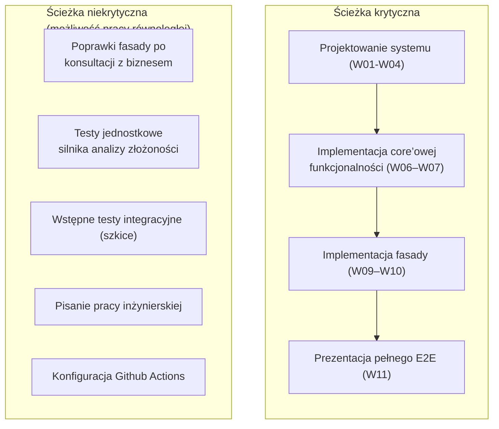

# Dokument etapu 1: Wymagania i zakres projektu  

**Projekt inżynierski -- Wyział Matematyki i Nauk Informacyjnych, Politechnika Warszawska**

## 1. Historia zmian i metadane dokumentu  

|Wersja|Data|Autorzy|Opis zmian|
|-|-|-|-|
|**1.0**|15.10.2026|Kamil Błażejczyk / Kornel Dzieża / Kacper Grobel|Wersja bazowa dokumentu|

**Tytuł projektu**: *Projekt i implementacja platformy testowej weryfikującej i profilującej rozwiązania programistyczne.*

**Tytuł w języku angielskim**: *Design and implementation of a testing framework for automated verification and profiling of programming assignments.*

**Autorzy:** Kamil Błażejczyk, Kacper Grobel, Kornel Dzieża.

## 2. Abstrakt  

Dokument określa wymagania i zakres projektu, czyli narzędzie do deterministycznej oceny złożoności algorytmów w C#. Pomiar będzie polegał na zliczaniu instrukcji w kodzie CIL, dzięki czemu wynik nie będzie zależny ani szybkości ani od maszyny, na której będzie uruchamiany kod, obciążenia systemu ani dokładności zegara maszyny. Projekt jest dedykowany automatycznemu sprawdzaniu prac studnetów na przedmiocie ASD2 i będzie działać z Github Actions.

Dokument zawiera: słownik pojęć, cele i zakres MVP, wymagania funkcjonalne w postaci User Stories, mierzalne wymagania niefunkcjonalne, harmonogram, analizę ryzyka. Stanowi podstawę do implementacji projektu oraz kolejnych Labolatoriów z przedmiotu Projekt Zespołowy. 

## 3. Sformułowanie problemu inżynierskiego

Celem projektu jest zaprojektowanie i zaimplementowanie bezpiecznej, zintegrowanej z IDE platformy testowej, umożliwiającej automatyczne generowanie kodu testów C#, izolację środowiska wykonawczego oraz weryfikację złożoności algorytmów.  

## 4. Spis treści  

  

  

## 5. Słownik pojęć  

|Pojęcie|Definicja|
|-|-|
|CIL (Common Intermediate Language)|Język pośredni, do którego kompiluje się kod C# przed wykonaniem przez środowisko .NET.|
|IL weaving / wplatanie instrukcji|Modyfikacja skompilowanego zestawu (assembly) przez dodanie instrukcji CIL, np. liczników operacji, bez zmiany kodu źródłowego.|
|IDE (Integrated Development Environment)|Program służący do tworzenia, modyfikowania, testowania i konserwacji oprogramowania.|
|Boilerplate code|Frgmenty kodu, które wielokrotnie powtarzają się w programie w podobnych lub identycznych formach.|
|Mono.Cecil|Biblioteka do odczytu i modyfikacji kodu CIL, używana jako Injector instrukcji.|
|Roslyn|Platforma kompilatora .NET, używana do analizy składni, kompilacji w pamięci i Source Generators.|
|Source Generator|Komponent Roslyn generujący kod w takcie kompilacji. Tutaj tworzy kod testów z atrybutów.|
|Atrybut złożoności|Autorski atrybut C# opisujący wymaganą złożoność czasową i pamięciową testowanego rozwiązania.|
|Złożoność obliczeniowa|Zależność liczby operacji lub zajętej pamięci od rozmiaru danych wejściowych.|
|Test Framework|Warstwa fasadowa: definicja testów, integracja z IDE i uruchamiane przez wrapper MSTest.|
|Test Coordinator|Część Test Executora zarządzająca przebiegiem testu i składająca wynik.|
|Container Worker|Proces w konterze Docker, w którym uruchamiany jest kod studenta.|
|Piaskownica| Izolowane środowisko kontenerowane, które blokuje niedozwolone wywołania systemowe i zatrzymuje proces po ich wykryciu.|
|Test niejawny| Test, którego dane i konfiguracja nie są widoczne dla studenta i są przekazywane z CI/CD w szyfrowanych zmiennych.|
|CI/CD|Continuous Integration / Continuous Deployment, czyli automatyczne budowanie i testowanie przy każdej zmianie kodu.|
|Github Actions|System CI/CD Github. Platforma jest udostępniana jako akcja.|
|APD| Archiwum Prac Dyplomowych PW, czyli portal do złożenia, weryfikacji antyplagiatowej i archiwizacji pracy.| 
|ASD2|Przedmiot „Algorytmy i Struktury Danych 2”, dla którego jest dedykowany ten projekt|
| CL | Terminal (eng. Command Line) |

## 6. Podsumowanie menedżerskie

Projekt dostarcza framework do tworzenia i przeprowadzania automatycznych testów poprawności i złożoności rozwiązań studentów z zastosowaniem sprawiedliwej metryki, niezależnej od chwilowego obciążenia czy specyfikacji maszyny uruchamiającej. Rozwiązania są analizowane pod kątem niedozwolonych wywołań i konteneryzowane.

### 6.1 Problem

Ocena zadań z ASD2 opiera się obecnie na systemie weryfikującym, który został napisany w archaicznej -- jak na współczesne standardy -- wersji czwartej .NET Frameworka. Wymusza to na studentach wykorzystanie starej platformy, nieobsługującej współczesnych wersji języka C#. 

Ponadto, obecna sprawdzarka jest bardzo wrażliwa na nadużycia ze strony studentów. Dla przykładu, w bardzo prosty sposób można zawiesić cały system -- poprzez zwykłe wypisanie komunikatu na standardowe wyjście (`stdout`). Tak więc obecne rozwiązanie nie jest niezawodne, czy odporne na złośliwe wejście.

Kolejnym problemem jest niedeterministycznie liczony czas działania rozwiązania, który jest zależny od obłożenia serwera. Powoduje to sytuację, w której student po wysłaniu kodu do sprawdzarki może dostać odmienne wyniki (jeżeli chodzi o złożoność) w zależności od godziny, w której zgłosił swoje rozwiązanie do sprawdzenia.

### 6.2 Rozwiązanie  

Nowa platforma, która modyfikuje skompilowany kod rozwiązania (wplata instrukcje CIL), tak aby zliczane były wykonane operacje i na jej podstawie liczona była faktyczna złożoność rozwiązania studenta. Dzięki temu wynik powinien być deterministyczny i niezależny od sprzętu. Kod jest uruchamiany w izolowanym kontenerze Docker, który blokuje niedozwolone wywołania systemowe.  

[comment]: # (### 6.3 Prowadzący zajęcia, który definiuje zadania i testy oraz studenci, którzy uruchamiają swoje testy w swoim IDE i widzą wynik w linii komend.)

## 7. Zakres projektu

### 7.1 Zakres MVP

MVP obejmuje pięć elementów z zgłoszenia tematu:

1.  Generator kodu testów,
2.  Silnik wplatający instrukcje CIL i zliczających operacje oraz alokacje,
3.  Obsługa testów niejawnych uruchamianych poza komputerem użytwkownika,
4.  Izolowana piaskownica kontenerowana z monitorowaniem wywołań systemowych i filtrowaniem niedozwolonych wywołań (np. operacji wejścia i wyjścia),
5.  Wdrożenie systemu z Github Actions, sprawdzona na zestawach zadań z ASD2.  
    
### 7.2 Poza zakresem MVP

1.  Obsługa języków innych niż C#,
2.  Interfejs graficzny poza integracją z IDE i raportem w *command line*.

## 8. Wymagania funkcjonale

Wymagania opisano jako *user stories*. Role:
- **Prowadzący**: autor zadania i testów, 
- **Student**: autor testowenego rozwiązania, 
- **Opiekun systemu**: osoba dbająca o poprawne działanie systemu i jego rozwój.

### 8.1 US-01: Definicja testu złożoności artybutami
- **Jako**: Prowadzący 
- **chcę**: w prosty sposób definiować testy z użyciem fasady
- **aby**: ograniczyć czas marnowany na pisanie *boilerplate code*.

Kryteria akceptacji:

- **Given**: klasa oznaczona atrybutami rozwiązań i przypadków testowych,
- **When**: projekt zostaje skompilowany,
- **Then**: *Source Generator* tworzy kod testów, które pojawiają się w eksploratorze testów IDE.
- **Scenariusz** (błędny atrybut): gdy atrybut ma niepoprawne argumenty, kompilacja kończy się diagnostyką z opisem błędu.

### 8.2 US-02: Uruchamianie testów w IDE
- **Jako**: Student 
- **chcę**: uruchomić testy swojego rozwiązania w IDE,
- **aby**: znać wynik przed wysłaniem kodu.

Kryteria akceptacji:

- **Given**: projekt z testami,
- **When**: Student uruchamia test z poziomu IDE,
- **Then**: Test Framework przekazuje test do Test Executora, a po jego wykonaniu pokazuje wynik jak każdy inny test jednostkowy.

### 8.3 US-03: Pomiar złożoności przez zliczanie instrukcji
- **Jako**: Prowadzący
- **chcę**: aby złożoność była mierzona liczbą wykonanych operacji i alokacji, 
- **aby**: ocena nie zależała od sprzętu i obciążenia.

Kryteria akceptacji:

- **Given**: skompilowane rozwiązanie i dane wejściowe o rosnącym rozmiarze,
- **When**: Executor wplata instrukcje liczników i uruchamia kod,
- **Then**: wynik zawiera liczbę operacji i alokacji dla każdego rozmiaru danych i werdykt zgodności z wymaganą złożonością. 
- **Scenariusz** (powtarzalność): dwa uruchomienia tego samego kodu na tych samych danych dają identyczne liczniki.

### 8.4 US-04: Sprawdzenie poprawności wyniku 
- **Jako**: Student 
- **chcę**: zobaczyć, czy wynik mojego kodu zgadza się z oczekiwanym, 
- **aby**: odróżnić błędny algorytm od zbyt wolnego.

Kryteria akceptacji:

- **Given**: zestaw danych wejściowych i oczekiwanych wyników,
- **When**: rozwiązanie zostaje wykonane
- **Then**: wynik testu raportuje osobno poprawność i złożoność.

### 8.5 US-05: Czytelny komunikat błędu kompilacji i analizy statycznej
- **Jako**: Student
- **chcę**: dostać zrozumiały komunikat, gdy mój kod się nie kompiluje, 
- **aby**: go poprawić.

Kryteria akceptacji:

- **Given**: plik źródłowy C# z błędami składni,
- **When**: Test Executor uruchamia analizę statyczną i kompilację,
- **Then**: test kończy się niepowodzeniem z komunikatem wskazującym miejsce błędu, a kod nie jest uruchamiany.

### 8.6 US-06: Blokowanie niedozwolonych operacji
- **Jako**: Prowadzący 
- **chcę**: zablokować w rozwiązaniach operacje wejścia-wyjścia i inne niedozowolone wywołania,
- **aby**: kod studenta nie mógł czytać testów ani nadużywać systemu.

Kryteria akceptacji:

- **Given**: rozwiązanie zawierające niedozwolone wywołanie (np. odczyt pliku),
- **When**: kod jest analizowany, wplatany i uruchamiany w kontenerze,
- **Then**: wywołanie zostanie odrzucone na poziomie CIL lub proces zostaje zatrzymany po wykryciu zakazanej operacji systemowej, a wynik oznacza naruszenie reguł.
 
### 8.7 US-07: Kontrola bibliotek i namespace'ów
- **Jako**: Prowadzący
- **chcę**: zablokować w rozwiązaniach studentów możliwość wykorzystywania niedozwolonych bibliotek,
- **aby**: student wymyślił własne rozwiązanie korzystając wyłącznie z dozwolonych bibliotek (standardowych).

Kryteria akceptacji:

- **Given**: test z listą zabronionych przestrzeni nazw, typów lub metod w ustawieniach testu (np. w atrybucie) oraz rozwiązanie studenta, które używa jednego z zabronionych elementów,
- **When**: Test Executor uruchamia analizę statyczną i sprawdzenie referencji przed wykonaniem, 
- **Then** test kończy się niepowodzeniem z komunikatem wskazującym, co zostało użyte i gdzie (element, plik, linia). Kod nie jest uruchamiany, a pozostałe testy działają niezależnie.
- **Scenariusz** (dozwolone użycie): rozwiązanie używa tylko dozwolonych bibliotek, więc kontrola przechodzi, a test wykonuje się normalnie.
- **Scenariusz** (próba obejścia): zabroniony element użyty przez pełną nazwę kwalifikowaną, alias `using` lub metodę rozszerzającą jest wykryty tak samo. Wykrywanie opiera się na symbolach i CIL, a nie na wyszukiwaniu tekstu.
- **Scenariusz** (błędna konfiguracja): lista zawiera nieistniejącą nazwę, więc kompilacja testu kończy się diagnostyką z opisem błędu.

### 8.8 US-08: Izolowane wykonanie kodu
- **Jako**: Opiekun systemu,
- **chcę**: aby każde rozwiązanie działało we własnym kontenerze,
- **aby**: jedno rozwiązanie nie wpływało na inne ani na system gospodarza.

Kryteria akceptacji:

- **Given**: lista rozwiązań wielu studentów,
- **When**: Test Executor uruchamia testy,
- **Then**: każde rozwiązanie jest wykonwane w osobnym kontenerze Docker, a awaria jednego nie przerywa pozostałych.
 
### 8.9 US-09: Testy niejawne
- **Jako**: Prowadzący,
- **chcę**: uruchamiać testy, których dane są ukryte przed studentami,
- **aby**: rozwiązanie nie było dopasowane do jawnych przykładów.

Kryteria akceptacji:

- **Given**: konfiguracja testu niejawnego przekazana przez mechanizmy CI/CD,
- **When**: akcja uruchamia testy,
- **Then**: dane wejściowe są przekazywane tylko do środowiska wykonawczego. Do studenta trafiają wyłącznie otrzymane wyniki zderzone z oczekiwanymi, nie dane do testów niejawnych.

### 8.10 US-10: Uruchomienie jako akcja GitHub Actions
- **Jako**: Opiekun systemu,
- **chcę**: dodać platformę do repozytorium jako akcję,
- **aby**: każdy push rozwiązania był oceniany automatycznie.

Kryteria akceptacji:

- **Given**: repozytorium z workflow używającym akcji platformy,
- **When**: Student wysyła kod do repozytorium,
- **Then**: workflow uruchamia testy i publikuje wynik (poprawność, złożoność, komunikat błędu) w terminalu bądź na stronie internetowej.

## 9. Wymagania niefunkcjonalne

Każde wymaganie ma metrykę i sposób weryfikacji, zgodnie z podejściem FURPS. Wartości 

| ID     | Kategoria      | Wymaganie                              | Metryka docelowa                                                                                                                                            | Weryfikacja                                             |
| ------ | -------------- | -------------------------------------- | ----------------------------------------------------------------------------------------------------------------------------------------------------------- | ------------------------------------------------------- |
| NFR-01 | Reliability    | Deterministyczny pomiar                | Liczniki operacji i alokacji identyczne w 100% z 10 kolejnych uruchomień tego samego kodu i danych                                                          | Test automatyczny z powtórzeniami, na różnych maszynach |
| NFR-02| Functionality| Trafność oceny złożoności | Poprawny werdykt dla $\ge$ 95% rozwiązań wzorcowych i celowo błędnych z zestawu referencyjnego ($O(n)$, $O(nlogn)$, $O(n^2)$) | Zestaw referencujny z zadań ASD2 |
| NFR-03 | Performance    | Narzut instrumentacji| Wykonanie z licznikami nie więcej niż 5× wolniejsze niż bez nich| Benchmark na zestawie referencyjnym |
| NFR-04 | Preformance | Czas oceny jednego rozwiązania | $\le$ 30 s razem z uruchomieniem kontenera, dla typowego zadania ASD2 | Pomiar w CL, 20 uruchomień |
| NFR-05 | Reliability | Izolacja i blokada zakazanych operacji | 100% próbek z zestawu testowego zablokowanych (I/O, sieć, uruchomienie procesów, odczyt plików testów) | Zestaw złośliwych próbek uruchamiany w CL |
| NFR-06 | Reliability | Odporność na błędny kod | 0 nieobsłużonych wyjątków Executora dla kodu niekompilującego się, z nieskończoną pętlą i z nadmierną alokacją. Proces przerwany po limicie czasu i pamięci | Testy integracyjne z kodem uszkodzonym |
| NFR-07 | Functionality | Ochrona testów niejawnych | 0 wystąpień danych niejawnych w repozytorium, logach i wynikach | Skan logów i artefaktów po przebiegu CL |
| NFR-08 | Usability | Integracja z IDE | Testy widoczne i uruchamianlne w co najmniej jednym IDE obsługującym MSTest lub xUnit, bez dodatkowej wtyczki | Test ręczny według scenaiusza US-02 |
| NFR-09 | Supportability | Powtarzalne wdrożenie | Wymagane tylko .NET 10 i Docker. Dodanie akcji do nowego repozytorium zajmuje $\le$ 15 min według instrukcji | Próba na czystym repozytorium i czystej maszynie |
| NFR-10 | Supportablitity | Jakość kodu i testy | Pokrycie testami jednostkowymi z $\ge$ 70% kodu platformy, wszystkie testy zielone w CL przed scaleniem | Raport poktrycia CL | 

## 10. Harmonogram projektu

### 10.1. Założenia harmonogramu

* Długość semestru: 15 tygodni zajęć.
* Ostateczny termin wysłania pracy do APD: **1 lutego 2027**.
* Zgodnie z zaleceniami z wykładu L1, harmonogram zakłada dwutygodniowy okres zamrożenia pracy nad nowymi funkcjonalnościami (*feature freeze*) w tygodniu 12, w celu uniknięcia przesunięcia pracy na styczeń.

### 10.2. Harmonogram w ujęciu tygodniowym

|Tydzień|Cel|Zakres pracy|Odpowie-dzialny|Bufor ryzyka|
| :----------------: | :------------------------ | :----------------------------------------------------------------------------------- | :-------------------: | :---------------: |
| **W01–W02** |Koncepcja i start projektu| Uzgodnienie zakresu z promotorem, stworzenie repozytorium gita, praca nad specyfikacją i dokumentacją zakresu projektu|Kornel Dzieża|--|
|   **W03**   | **Etap 1 (Lab)**|Oddanie dokumentu ze specyfikacją, zakresem MVP, wymaganiami niefunkcjonalnymi, harmonogramem i rejestrem ryzyk|Kornel Dzieża|3 dni|
|   **W04**   |Projektowanie architektury rozwiązania|Praca nad dokumentacją architektury systemu, analiza potrzeb biznesowych w kontekście fasady, podział systemu na moduły|Kamil Błażejczyk|--|
|   **W05**   | **Etap 2 (Lab)**   |Oddanie dokumentacji architektury systemu|Kamil Błażejczyk|3 dni|
| **W06–W07** |Implementacja core'owej funkcjonalności|Implementacja silnika analizy złożoności algorytmu i modułów odpowiedzialnych za uruchomienie testów|Kacper Grobel|--|
|   **W08**   | **Etap 3 (Lab)**   |Oddanie core'owej funkcjonalności (pierwsze przykłady działające end-to-end)|Kacper Grobel|3 dni|
| **W09–W10** |Implementacja fasady|Podłączenie fasady do modułów uruchamiających testy, skonfigurowanie Github Actions.|Kamil Błażejczyk|   --|
|   **W11**   | **Etap 4 (Lab)**   |Oddanie wersji *prerelease* i raport z testów integracyjnych, prezentacja pełnego E2E|Kamil Błażejczyk|3 dni|
|   **W12**   | **FEATURE FREEZE**  |Całkowite powstrzymanie się od dodawania nowych funkcjonalności. System w 100% stabilny.|wszyscy|2 tyg.|
|   **W13**   | **Etap 5 (Lab)**   | **Ostateczna akceptacja aplikacji** w laboratorium MiNI, jednostronicowa instrukcja obsługi|wszyscy|--|
|   **W14–W15**   |Dokończenie pracy|Pisanie pracy w LaTeX, deklaracja użycia AI, antyplagiat, akceptacja od promotora|Kornel Dzieża|5 dni|
| **Styczeń** |Wysłanie artefaktów do APD|Stworzenie paczki do APD, wysłanie pracy, recenzje|wszyscy|do 1 lutego 2027|

### 10.3. Identyfikacja ścieżki krytycznej

Ścieżka krytyczna determinuje najwcześniejszą możliwą datę ukończenia projektu.

## 11. Wstępny rejestr ryzyk

### 11.1 Rejestr ryzyk projektowych i technicznych

|ID|Ryzyko|Prawdop. (L/M/H)|Wpływ (L/M/H/Crit)|Właściciel ryzyka|Strategia ograniczenia|
|-|-|-|-|-|-|
| **RSK-01** | **Niewydolność docelowego hardware'u**                     |         M         |          H          | Kornel D. | 0 |
| **RSK-02** | **Niekompatybilność z oprogramowaniem komputerów labolatoryjnych** |         L         |        Crit        | Kamil B. | 0 |
| **RSK-03** | **Wyciek kodu źródłowego**   |         M         |       L        | wscyscy | Prywatne repozytorium projektu oraz dostępność tylko skompilowanej wersji blioteki.                         |
| **RSK-04** | **Awaria serwerów GitHub**   |         L         |       H        | wszyscy | Przechowywanie aktualnej lokalnej kopii repozytorium na urządzeniach osobistych                         |
| **RSK-05** | **Choroba/Odejście członka zespołu** | L | Crit | wszyscy |Dobry podział systemu na moduły.|

### 11.2 Plany awaryjne dla modułów wysokiego ryzyka

#### 11.2.1 Protokół awaryjny 1: Niemożliwosć obliczenia złożoności metod zapomocą zmiany kodu IL

* **Plan A (Główny):** Zliczanie narzutu obliczeniowego poprzez zliczanie ilosci występujących instrukcji z uwzględnieniem ich złożoności.
* **Plan B Trigger:** Niemożliwość określenia złożoności pojedynczej instrukcji IL albo niemożliwość zaimplementowania licznika w skompilowanym kodzie.
* **Plan B (Contingency):** Obliczanie złożoności za pomocą upłyniętego czasu.

#### 11.2.2 Protokół awaryjny 2: Niemożliwość wglądu lub modyfikacji kodu zewnętrznych bibliotek

* **Plan A (Główny):** Dynamiczne przechwytywanie zewnętrznych plików .dll w locie i modyfikowanie ich kodu poprzez wtrzykiwanie instrukcji bezpośrednio w środowisku wykonawczym.
* **Plan B Trigger:** Napotkanie ograniczeń środowiska .NET uniemożliwiających dostanie się do kodu bibliotek.
* **Plan B (Contingency):** Wcześniejsze statyczne przygotowanie i modyfikacja wymaganych bibliotek (pochodzących z dostępnej dla studenta puli) przed testem, po czym dynamiczna podmiana standardowych odwołań w kodzie studenta na te pre-kompilowane, zmodyfikowane wersje
* **Plan C Trigger:** Problem z podmianą całych plików .dll lub brak możliwości ich wcześniejszego bezpiecznego zmapowania w środowisku testowym.
* **Plan C (Contingency):** Zaimplementowanie własnych warstw pośrednich (wrapperów) na wszystkie wymagane biblioteki zewnętrzne. Wrapper ten wewnątrz swoich metod zlicza złożoność operacji.
* **Plan D Trigger:** Zbyt wysoka złożoność implementacyjna, duży narzut czasowy lub trudności techniczne w przygotowaniu i utrzymaniu kompletnych wrapperów dla wszystkich bibliotek zewnętrznych.
* **Plan D (Contingency):** Rezygnacja ze szczegółowego zliczania operacji IL dla zewnętrznych zależności i powrót do profilowania opartego na narzucie czasowym w izolowanym środowisku.

#### 11.2.3 Protokół awaryjny 3: Nieakceptowalny narzut czasowy generowany przez wtrącanie kodu IL

* **Plan A (Główny):** Bezpośrednia, liniowa inkrementacja licznika operacji po każdej pojedynczej instrukcji IL w skompilowanym kodzie.
* **Plan B Trigger:** Wyniki benchmarków wykazujące, że narzut wydajnościowy związany z ciągłym podbijaniem liczników przy każdej instrukcji drastycznie spowalnia wykonywanie testów.
* **Plan B (Contingency):** Optymalizacja mechanizmu wtrącania kodu poprzez podział kodu na logiczne bloki podstawowe, zliczanie złożoności wewnątrz całego bloku i wstawianie pojedynczej instrukcji inkrementacji sumarycznej na samym początku danego bloku (zamiast po każdej instrukcji).
* **Plan C Trigger:** Po optymalizacji blokowej narzut czasowy inkrementacji dalej uniemożliwia jednoczesne testowanie funkcjonalne i profilowanie wydajnościowe.
* **Plan C (Contingency):** Całkowite oddzielenie procesu liczenia złożoności od standardowych testów funkcjonalnych.

## 12. Podział ról

|Osoba|Zakres|
|-|-|
|Kamil Błażejczyk|Architektura systemu, środowisko uruchomieniowe do testów, konteneryzacja, CI/CD|
|Kacper Grobel|Biblioteka do manipulacji kodem na poziomie kodu IL.|
|Kornel Dzieża|Generator automatyczny testów (Roslyn), dostosowanie manipulacji IL do bibliotek|

## 13. Formalna akceptacja promotora
Zatwierdzenie zakresu i MVP: Promotor zapoznał się ze specyfikacją wymagań i zatwierdza zakres MVP jako fundament projektu inżynierskiego.

Podpis promotora: ... ... ... ... ... ... ... ... ... ... ... ... ... ... ... ... ... ... ... ... ... ... ...

Data: ... października 2026 r.
