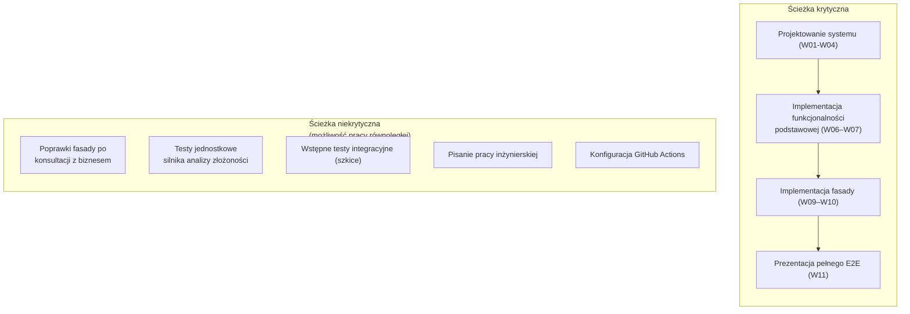

# Dokument etapu 1: Wymagania i zakres projektu

**Projekt inżynierski — Wydział Matematyki i Nauk Informacyjnych, Politechnika Warszawska**

**Tytuł projektu**: *Projekt i implementacja platformy testowej weryfikującej i profilującej rozwiązania programistyczne.*

**Tytuł w języku angielskim**: *Design and implementation of a testing framework for automated verification and profiling of programming assignments.*

**Autorzy:**
  * **Kacper Grobel** – `kacper.grobel.stud@pw.edu.pl`
  * **Kamil Błażejczyk** – `kamil.blazejczyk.stud@pw.edu.pl`
  * **Kornel Dzieża** – `kornel.dzieza.stud@pw.edu.pl`

**Promotorzy:**
  * **Mgr inż. Tomasz Herman** – `tomasz.herman@pw.edu.pl`
  * **Dr inż. Michał Dębski** – `michal.debski@pw.edu.pl`

**Główne repozytorium:** `https://github.com/kamil7430/cil-complexity-analyzer`

## 1. Historia zmian i metadane dokumentu

| Wersja  | Data       | Autorzy                                          | Opis zmian                                                                                                    |
|---------|------------|--------------------------------------------------|---------------------------------------------------------------------------------------------------------------|
| **1.0** | 15.10.2026 | Kamil Błażejczyk / Kornel Dzieża / Kacper Grobel | Wersja bazowa dokumentu                                                                                       |
| **1.1** | 18.10.2026 | Kamil Błażejczyk / Kornel Dzieża / Kacper Grobel | Poprawki po uwagach promotora: styl, terminologia, słownik pojęć, zakres MVP, metoda oceny złożoności (US-03) |

## 2. Abstrakt

Dokument określa wymagania i zakres projektu, którego celem jest narzędzie do deterministycznej oceny złożoności algorytmów napisanych w języku C#. Pomiar polega na zliczaniu instrukcji w kodzie CIL, dzięki czemu wynik nie zależy od szybkości maszyny wykonującej kod, obciążenia systemu ani dokładności zegara. Projekt jest przeznaczony do automatycznego sprawdzania prac studentów w ramach przedmiotu ASD2 i działa w środowisku GitHub Actions.

Dokument zawiera: słownik pojęć, cele i zakres MVP, wymagania funkcjonalne w postaci historyjek użytkownika (user stories), mierzalne wymagania niefunkcjonalne, harmonogram oraz analizę ryzyka. Stanowi podstawę do implementacji projektu oraz kolejnych etapów laboratoryjnych przedmiotu *Projekt zespołowy*.

## 3. Sformułowanie problemu inżynierskiego

Celem projektu jest zaprojektowanie i implementacja bezpiecznej platformy testowej zintegrowanej z IDE. Platforma umożliwia automatyczne generowanie kodu testów w C#, izolację środowiska wykonawczego oraz weryfikację złożoności algorytmów.

## 4. Spis treści

- [1. Historia zmian i metadane dokumentu](#1-historia-zmian-i-metadane-dokumentu)
- [2. Abstrakt](#2-abstrakt)
- [3. Sformułowanie problemu inżynierskiego](#3-sformułowanie-problemu-inżynierskiego)
- [4. Spis treści](#4-spis-treści)
- [5. Słownik pojęć](#5-słownik-pojęć)
- [6. Podsumowanie menedżerskie](#6-podsumowanie-menedżerskie)
  - [6.1 Problem](#61-problem)
  - [6.2 Rozwiązanie](#62-rozwiązanie)
- [7. Zakres projektu](#7-zakres-projektu)
  - [7.1 Zakres MVP](#71-zakres-mvp)
  - [7.2 Poza zakresem MVP](#72-poza-zakresem-mvp)
- [8. Wymagania funkcjonalne](#8-wymagania-funkcjonalne)
  - [8.1 US-01: Definicja testu złożoności atrybutami](#81-us-01-definicja-testu-złożoności-atrybutami)
  - [8.2 US-02: Uruchamianie testów w IDE](#82-us-02-uruchamianie-testów-w-ide)
  - [8.3 US-03: Pomiar i weryfikacja złożoności przez zliczanie instrukcji](#83-us-03-pomiar-i-weryfikacja-złożoności-przez-zliczanie-instrukcji)
  - [8.4 US-04: Sprawdzenie poprawności wyniku](#84-us-04-sprawdzenie-poprawności-wyniku)
  - [8.5 US-05: Czytelny komunikat o błędzie kompilacji i analizy statycznej](#85-us-05-czytelny-komunikat-o-błędzie-kompilacji-i-analizy-statycznej)
  - [8.6 US-06: Blokowanie niedozwolonych operacji](#86-us-06-blokowanie-niedozwolonych-operacji)
  - [8.7 US-07: Kontrola bibliotek i przestrzeni nazw](#87-us-07-kontrola-bibliotek-i-przestrzeni-nazw)
  - [8.8 US-08: Izolowane wykonanie kodu](#88-us-08-izolowane-wykonanie-kodu)
  - [8.9 US-09: Testy niejawne](#89-us-09-testy-niejawne)
  - [8.10 US-10: Uruchomienie jako akcja GitHub Actions](#810-us-10-uruchomienie-jako-akcja-github-actions)
- [9. Wymagania niefunkcjonalne](#9-wymagania-niefunkcjonalne)
- [10. Harmonogram projektu](#10-harmonogram-projektu)
  - [10.1. Założenia harmonogramu](#101-założenia-harmonogramu)
  - [10.2. Harmonogram w ujęciu tygodniowym](#102-harmonogram-w-ujęciu-tygodniowym)
  - [10.3. Identyfikacja ścieżki krytycznej](#103-identyfikacja-ścieżki-krytycznej)
- [11. Wstępny rejestr ryzyk](#11-wstępny-rejestr-ryzyk)
  - [11.1 Rejestr ryzyk projektowych i technicznych](#111-rejestr-ryzyk-projektowych-i-technicznych)
  - [11.2 Plany awaryjne dla modułów wysokiego ryzyka](#112-plany-awaryjne-dla-modułów-wysokiego-ryzyka)
- [12. Podział ról](#12-podział-ról)
- [13. Formalna akceptacja promotora](#13-formalna-akceptacja-promotora)

## 5. Słownik pojęć

| Pojęcie                                                                    | Definicja                                                                                                                                                                                                                              |
|----------------------------------------------------------------------------|----------------------------------------------------------------------------------------------------------------------------------------------------------------------------------------------------------------------------------------|
| CIL (Common Intermediate Language)                                         | Język pośredni, do którego kompiluje się kod C# przed wykonaniem przez środowisko uruchomieniowe .NET.                                                                                                                                 |
| IL weaving / wplatanie instrukcji                                          | Modyfikacja skompilowanego zestawu (assembly) przez dodanie instrukcji CIL, np. liczników operacji, bez zmiany kodu źródłowego.                                                                                                        |
| IDE (Integrated Development Environment)                                   | Program służący do tworzenia, modyfikowania, testowania i konserwacji oprogramowania.                                                                                                                                                  |
| Kod szablonowy (boilerplate code)                                          | Fragmenty kodu powtarzające się w programie w podobnej lub identycznej formie.                                                                                                                                                         |
| Mono.Cecil                                                                 | Biblioteka do odczytu i modyfikacji kodu CIL, używana do wplatania instrukcji.                                                                                                                                                         |
| Roslyn                                                                     | Platforma kompilatora .NET, używana do analizy składni, kompilacji w pamięci i generowania kodu przez Source Generator.                                                                                                                |
| Source Generator                                                           | Komponent Roslyn generujący kod w trakcie kompilacji. W projekcie tworzy kod testów na podstawie atrybutów.                                                                                                                            |
| Atrybut złożoności                                                         | Autorski atrybut C# opisujący wymaganą złożoność czasową i pamięciową testowanego rozwiązania.                                                                                                                                         |
| Złożoność obliczeniowa                                                     | Zależność liczby operacji lub zajętej pamięci od rozmiaru danych wejściowych.                                                                                                                                                          |
| Test Framework                                                             | Warstwa fasadowa: definicja testów, integracja z IDE i uruchamianie testów za pośrednictwem MSTest.                                                                                                                                    |
| Test Coordinator                                                           | Część komponentu Test Executor zarządzająca przebiegiem testu i składająca jego wynik.                                                                                                                                                 |
| Container Worker                                                           | Proces w kontenerze Docker, w którym uruchamiany jest kod studenta.                                                                                                                                                                    |
| Piaskownica                                                                | Kontener, który blokuje niedozwolone wywołania systemowe i zatrzymuje proces po ich wykryciu.                                                                                                                                          |
| Test niejawny                                                              | Test, którego dane i konfiguracja nie są widoczne dla studenta i są przekazywane ze środowiska CI/CD w szyfrowanych zmiennych.                                                                                                         |
| CI/CD (Continuous Integration / Continuous Deployment)                     | Automatyczne budowanie, testowanie i wdrażanie oprogramowania przy każdej zmianie kodu. Środowisko wykonujące te czynności nazywa się środowiskiem CI.                                                                                 |
| GitHub Actions                                                             | System CI/CD serwisu GitHub. Platforma jest udostępniana jako akcja.                                                                                                                                                                   |
| APD (Archiwum Prac Dyplomowych)                                            | Portal Politechniki Warszawskiej służący do złożenia, weryfikacji antyplagiatowej i archiwizacji pracy dyplomowej.                                                                                                                     |
| ASD2 (Algorytmy i Struktury Danych 2)                                      | Przedmiot, dla którego jest przeznaczony ten projekt.                                                                                                                                                                                  |
| CLI (Command Line Interface)                                               | Interfejs tekstowy, w którym programem steruje się poleceniami wpisywanymi w terminalu; wynik jest wypisywany w terminalu.                                                                                                             |
| C#                                                                         | Obiektowy język programowania ogólnego przeznaczenia, kompilowany do kodu CIL. Język, w którym studenci piszą rozwiązania.                                                                                                             |
| .NET (.NET Framework)                                                      | Platforma programistyczna firmy Microsoft, w skład której wchodzi środowisko uruchomieniowe wykonujące kod CIL. .NET Framework to jej starsza, przestarzała wersja, dostępna tylko w systemie Windows. Projekt wymaga .NET 10.         |
| Docker                                                                     | Narzędzie do konteneryzacji aplikacji.                                                                                                                                                                                                 |
| FURPS (Functionality, Usability, Reliability, Performance, Supportability) | Model klasyfikacji wymagań niefunkcjonalnych według pięciu kategorii jakości.                                                                                                                                                          |
| MVP (Minimum Viable Product)                                               | Minimalna wersja produktu realizująca podstawowe wymagania, wystarczająca do weryfikacji założeń projektu.                                                                                                                             |
| Kontener / konteneryzacja                                                  | Kontener to izolowane środowisko uruchomieniowe aplikacji, współdzielące jądro systemu operacyjnego gospodarza. Konteneryzacja to uruchamianie aplikacji w takich kontenerach.                                                         |
| Przestrzeń nazw (namespace)                                                | Mechanizm C# grupujący typy i organizujący ich nazwy, np. `System.IO`.                                                                                                                                                                 |
| Sprawdzarka                                                                | System automatycznie oceniający rozwiązania studentów. Dotyczy zarówno obecnie wykorzystywanego systemu, jak i projektowanej platformy.                                                                                                |
| Test Executor                                                              | Komponent uruchamiający testy: analizuje kod, wplata instrukcje, uruchamia rozwiązanie w kontenerze i zwraca wynik.                                                                                                                    |

Nazwy angielskie (np. Test Executor, Source Generator) są traktowane jako nazwy własne i nie podlegają odmianie. W tekście używa się formy „komponent Test Executor”, „środowisko CI” itd.

## 6. Podsumowanie menedżerskie

Projekt dostarcza framework do tworzenia i przeprowadzania automatycznych testów poprawności i złożoności rozwiązań studentów. Metryka złożoności nie zależy od chwilowego obciążenia ani od parametrów maszyny uruchamiającej testy. Rozwiązania są analizowane pod kątem niedozwolonych wywołań i uruchamiane w kontenerach.

### 6.1 Problem

Oceny zadań z ASD2 są obecnie wystawiane przez sprawdzarkę napisaną dla .NET Framework 4. Wymusza to na studentach korzystanie z przestarzałej platformy, która nie obsługuje współczesnych wersji języka C#.

Obecna sprawdzarka jest bardzo wrażliwa na nadużycia ze strony studentów. Na przykład wypisanie komunikatu na standardowe wyjście (stdout) zawiesza cały system. Rozwiązanie nie jest więc niezawodne ani odporne na złośliwe dane wejściowe.

Czas działania rozwiązania jest mierzony niedeterministycznie i zależy od obciążenia serwera. Ten sam kod wysłany do sprawdzarki może zatem uzyskać różne wyniki oceny złożoności w zależności od godziny zgłoszenia.

### 6.2 Rozwiązanie

Nowa platforma wplata instrukcje CIL w skompilowany kod rozwiązania, aby zliczać wykonane operacje, i na tej podstawie wyznacza złożoność rozwiązania studenta. Wynik jest deterministyczny i niezależny od sprzętu. Kod jest uruchamiany w kontenerze Docker, który blokuje niedozwolone wywołania systemowe.

## 7. Zakres projektu

### 7.1 Zakres MVP

MVP obejmuje:

- generator kodu testów,
- silnik wplatający instrukcje CIL, zliczający operacje i alokacje,
- obsługę testów niejawnych uruchamianych poza komputerem użytkownika,
- piaskownicę z monitorowaniem wywołań systemowych i filtrowaniem niedozwolonych wywołań (np. operacji wejścia-wyjścia),
- wdrożenie systemu w środowisku GitHub Actions, sprawdzone na zestawach zadań z ASD2.

### 7.2 Poza zakresem MVP

- Obsługa języków innych niż C#.
- Interfejs graficzny inny niż integracja z IDE i raport w CLI.

## 8. Wymagania funkcjonalne

Wymagania opisano jako historyjki użytkownika (user stories). Role:
- **Prowadzący**: autor zadania i testów,
- **Student**: autor testowanego rozwiązania,
- **Opiekun systemu**: osoba odpowiedzialna za poprawne działanie i rozwój systemu.

### 8.1 US-01: Definicja testu złożoności atrybutami
- **Jako**: Prowadzący
- **chcę**: definiować testy z użyciem fasady,
- **aby**: ograniczyć ilość kodu szablonowego.

Kryteria akceptacji:

- **Dane**: klasa oznaczona atrybutami rozwiązań i przypadków testowych,
- **Gdy**: projekt zostaje skompilowany,
- **Wtedy**: Source Generator tworzy kod testów, które pojawiają się w eksploratorze testów IDE.
- **Scenariusz** (błędny atrybut): gdy atrybut ma niepoprawne argumenty, kompilacja kończy się diagnostyką z opisem błędu.

### 8.2 US-02: Uruchamianie testów w IDE
- **Jako**: Student
- **chcę**: uruchomić testy swojego rozwiązania w IDE,
- **aby**: poznać wynik przed wysłaniem kodu.

Kryteria akceptacji:

- **Dane**: projekt z testami,
- **Gdy**: Student uruchamia test z poziomu IDE,
- **Wtedy**: Test Framework przekazuje test do komponentu Test Executor, a po jego wykonaniu wyświetla wynik tak jak dla każdego testu jednostkowego.

### 8.3 US-03: Pomiar złożoności przez zliczanie instrukcji
- **Jako**: Prowadzący
- **chcę**: aby złożoność była mierzona liczbą wykonanych operacji i alokacji, 
- **aby**: ocena nie zależała od sprzętu i obciążenia.

Kryteria akceptacji:

- **Given**: skompilowane rozwiązanie i dane wejściowe o rosnącym rozmiarze,
- **When**: Executor wplata instrukcje liczników i uruchamia kod,
- **Then**: wynik zawiera liczbę operacji i alokacji dla każdego rozmiaru danych i werdykt zgodności z wymaganą złożonością. 
- **Scenariusz** (powtarzalność): dwa uruchomienia tego samego kodu na tych samych danych dają identyczne liczniki.

### 8.4 US-04: Sprawdzenie poprawności wyniku
- **Jako**: Student
- **chcę**: zobaczyć, czy wynik mojego kodu zgadza się z oczekiwanym,
- **aby**: odróżnić błędny algorytm od zbyt wolnego.

Kryteria akceptacji:

- **Dane**: zestaw danych wejściowych i oczekiwanych wyników,
- **Gdy**: rozwiązanie zostaje wykonane,
- **Wtedy**: wynik testu raportuje osobno poprawność i złożoność.

### 8.5 US-05: Czytelny komunikat o błędzie kompilacji i analizy statycznej
- **Jako**: Student
- **chcę**: otrzymać zrozumiały komunikat, gdy mój kod się nie kompiluje,
- **aby**: go poprawić.

Kryteria akceptacji:

- **Dane**: plik źródłowy C# z błędami składni,
- **Gdy**: komponent Test Executor uruchamia analizę statyczną i kompilację,
- **Wtedy**: test kończy się niepowodzeniem z komunikatem wskazującym miejsce błędu, a kod nie jest uruchamiany.

### 8.6 US-06: Blokowanie niedozwolonych operacji
- **Jako**: Prowadzący
- **chcę**: zablokować w rozwiązaniach operacje wejścia-wyjścia i inne niedozwolone wywołania,
- **aby**: kod studenta nie mógł odczytywać testów ani nadużywać systemu.

Kryteria akceptacji:

- **Dane**: rozwiązanie zawierające niedozwolone wywołanie (np. odczyt pliku),
- **Gdy**: kod jest analizowany, instrumentowany i uruchamiany w kontenerze,
- **Wtedy**: wywołanie zostaje odrzucone na poziomie CIL albo proces zostaje zatrzymany po wykryciu zakazanej operacji systemowej, a wynik oznacza naruszenie reguł.

### 8.7 US-07: Kontrola bibliotek i przestrzeni nazw
- **Jako**: Prowadzący
- **chcę**: zablokować w rozwiązaniach studentów używanie niedozwolonych bibliotek,
- **aby**: student opracował własne rozwiązanie, korzystając wyłącznie z dozwolonych bibliotek (standardowych).

Kryteria akceptacji:

- **Dane**: test z listą zabronionych przestrzeni nazw, typów lub metod w ustawieniach testu (np. w atrybucie) oraz rozwiązanie studenta używające jednego z zabronionych elementów,
- **Gdy**: komponent Test Executor uruchamia analizę statyczną i sprawdzenie referencji przed wykonaniem,
- **Wtedy**: test kończy się niepowodzeniem z komunikatem wskazującym, co zostało użyte i gdzie (element, plik, linia). Kod nie jest uruchamiany, a pozostałe testy działają niezależnie.
- **Scenariusz** (dozwolone użycie): rozwiązanie używa tylko dozwolonych bibliotek, więc kontrola kończy się powodzeniem, a test wykonuje się normalnie.
- **Scenariusz** (próba obejścia): zabroniony element użyty przez pełną nazwę kwalifikowaną, alias `using` lub metodę rozszerzającą jest wykrywany tak samo. Wykrywanie opiera się na symbolach i CIL, a nie na wyszukiwaniu tekstu.
- **Scenariusz** (błędna konfiguracja): lista zawiera nieistniejącą nazwę, więc kompilacja testu kończy się diagnostyką z opisem błędu.

### 8.8 US-08: Izolowane wykonanie kodu
- **Jako**: Opiekun systemu
- **chcę**: aby każde rozwiązanie działało we własnym kontenerze,
- **aby**: jedno rozwiązanie nie wpływało na inne ani na system gospodarza.

Kryteria akceptacji:

- **Dane**: lista rozwiązań wielu studentów,
- **Gdy**: komponent Test Executor uruchamia testy,
- **Wtedy**: każde rozwiązanie jest wykonywane w osobnym kontenerze Docker, a awaria jednego nie przerywa pozostałych.

### 8.9 US-09: Testy niejawne
- **Jako**: Prowadzący
- **chcę**: uruchamiać testy, których dane są ukryte przed studentami,
- **aby**: rozwiązanie nie było dopasowane do jawnych przykładów.

Kryteria akceptacji:

- **Dane**: konfiguracja testu niejawnego przekazana przez mechanizmy CI/CD,
- **Gdy**: akcja uruchamia testy,
- **Wtedy**: dane wejściowe są przekazywane wyłącznie do środowiska wykonawczego. Student otrzymuje tylko wynik porównania uzyskanych wyników z oczekiwanymi, bez danych testów niejawnych.

### 8.10 US-10: Uruchomienie jako akcja GitHub Actions
- **Jako**: Opiekun systemu
- **chcę**: dodać platformę do repozytorium jako akcję,
- **aby**: każde wysłanie rozwiązania do repozytorium (push) było oceniane automatycznie.

Kryteria akceptacji:

- **Dane**: repozytorium z plikiem workflow używającym akcji platformy,
- **Gdy**: Student wysyła kod do repozytorium,
- **Wtedy**: workflow uruchamia testy i publikuje wynik (poprawność, złożoność, komunikat o błędzie) w terminalu lub na stronie internetowej.

## 9. Wymagania niefunkcjonalne

Każde wymaganie ma metrykę i sposób weryfikacji, zgodnie z modelem FURPS.

| ID     | Kategoria       | Wymaganie                              | Metryka docelowa                                                                                                                                                                    | Weryfikacja                                                |
|--------|-----------------|----------------------------------------|-------------------------------------------------------------------------------------------------------------------------------------------------------------------------------------|------------------------------------------------------------|
| NFR-01 | Reliability     | Deterministyczny pomiar                | Liczniki operacji i alokacji identyczne w 100% z 10 kolejnych uruchomień tego samego kodu i danych                                                                                  | Test automatyczny z powtórzeniami, na różnych maszynach    |
| NFR-02 | Functionality   | Trafność oceny złożoności              | Poprawny werdykt dla $\ge$ 95% rozwiązań wzorcowych i celowo błędnych z zestawu referencyjnego ($O(n)$, $O(n \log n)$, $O(n^2)$)                                                    | Zestaw referencyjny z zadań ASD2                           |
| NFR-03 | Performance     | Narzut instrumentacji                  | Wykonanie z licznikami nie więcej niż 5× wolniejsze niż bez nich                                                                                                                    | Pomiar wydajności na zestawie referencyjnym                |
| NFR-04 | Performance     | Czas oceny jednego rozwiązania         | $\le$ 30 s łącznie z uruchomieniem kontenera, dla typowego zadania ASD2                                                                                                             | Pomiar w CLI, 20 uruchomień                                |
| NFR-05 | Reliability     | Izolacja i blokada zakazanych operacji | 100% próbek z zestawu testowego zablokowanych (I/O, sieć, uruchamianie procesów, odczyt plików testów)                                                                              | Zestaw złośliwych próbek uruchamiany w CLI                 |
| NFR-06 | Reliability     | Odporność na błędny kod                | 0 nieobsłużonych wyjątków komponentu Test Executor dla kodu niekompilującego się, z nieskończoną pętlą i z nadmierną alokacją. Proces przerwany po przekroczeniu limitu czasu i pamięci | Testy integracyjne z kodem zawierającym błędy              |
| NFR-07 | Functionality   | Ochrona testów niejawnych              | 0 wystąpień danych niejawnych w repozytorium, logach i wynikach                                                                                                                     | Skanowanie logów i artefaktów po przebiegu w środowisku CI |
| NFR-08 | Usability       | Integracja z IDE                       | Testy widoczne i uruchamialne w co najmniej jednym IDE obsługującym MSTest lub xUnit, bez dodatkowej wtyczki                                                                        | Test ręczny według scenariusza US-02                       |
| NFR-09 | Supportability  | Powtarzalne wdrożenie                  | Wymagane tylko .NET 10 i Docker. Dodanie akcji do nowego repozytorium zajmuje $\le$ 15 min według instrukcji                                                                        | Próba na czystym repozytorium i czystej maszynie           |
| NFR-10 | Supportability  | Jakość kodu i testy                    | Pokrycie kodu platformy testami jednostkowymi $\ge$ 70%, wszystkie testy zakończone powodzeniem w środowisku CI przed scaleniem zmian                                               | Raport pokrycia z środowiska CI                            |

## 10. Harmonogram projektu

### 10.1. Założenia harmonogramu

* Długość semestru: 15 tygodni zajęć.
* Ostateczny termin wysłania pracy do APD: **1 lutego 2027**.
* Zgodnie z zaleceniami z wykładu L1, harmonogram zakłada dwutygodniowe zamrożenie prac nad nowymi funkcjonalnościami w tygodniu 12, aby uniknąć przesunięcia prac na styczeń.

### 10.2. Harmonogram w ujęciu tygodniowym

|   Tydzień   | Cel                                       | Zakres pracy                                                                                                            | Odpowiedzialny   |   Bufor ryzyka   |
|:-----------:|:------------------------------------------|:------------------------------------------------------------------------------------------------------------------------|:----------------:|:----------------:|
| **W01–W02** | Koncepcja i start projektu                | Uzgodnienie zakresu z promotorem, utworzenie repozytorium Git, praca nad specyfikacją i dokumentacją zakresu projektu   |  Kornel Dzieża   |        --        |
|   **W03**   | **Etap 1 (Lab)**                          | Oddanie dokumentu ze specyfikacją, zakresem MVP, wymaganiami niefunkcjonalnymi, harmonogramem i rejestrem ryzyk         |  Kornel Dzieża   |      3 dni       |
|   **W04**   | Projektowanie architektury rozwiązania    | Praca nad dokumentacją architektury systemu, analiza potrzeb biznesowych w kontekście fasady, podział systemu na moduły | Kamil Błażejczyk |        --        |
|   **W05**   | **Etap 2 (Lab)**                          | Oddanie dokumentacji architektury systemu                                                                               | Kamil Błażejczyk |      3 dni       |
| **W06–W07** | Implementacja funkcjonalności podstawowej | Implementacja silnika analizy złożoności algorytmu i modułów odpowiedzialnych za uruchamianie testów                    |  Kacper Grobel   |        --        |
|   **W08**   | **Etap 3 (Lab)**                          | Oddanie funkcjonalności podstawowej (pierwsze przykłady działające end-to-end)                                          |  Kacper Grobel   |      3 dni       |
| **W09–W10** | Implementacja fasady                      | Podłączenie fasady do modułów uruchamiających testy, konfiguracja GitHub Actions                                        | Kamil Błażejczyk |        --        |
|   **W11**   | **Etap 4 (Lab)**                          | Oddanie wersji przedpremierowej i raportu z testów integracyjnych, prezentacja pełnego scenariusza end-to-end           | Kamil Błażejczyk |      3 dni       |
|   **W12**   | **ZAMROŻENIE FUNKCJONALNOŚCI**            | Całkowite wstrzymanie dodawania nowych funkcjonalności. System w pełni stabilny.                                        |     wszyscy      |      2 tyg.      |
|   **W13**   | **Etap 5 (Lab)**                          | **Ostateczna akceptacja aplikacji** w laboratorium MiNI, jednostronicowa instrukcja obsługi                             |     wszyscy      |        --        |
| **W14–W15** | Dokończenie pracy                         | Pisanie pracy w LaTeX, deklaracja użycia AI, weryfikacja antyplagiatowa, akceptacja promotora                           |  Kornel Dzieża   |      5 dni       |
| **Styczeń** | Wysłanie artefaktów do APD                | Przygotowanie paczki do APD, wysłanie pracy, recenzje                                                                   |     wszyscy      | do 1 lutego 2027 |

### 10.3. Identyfikacja ścieżki krytycznej

Ścieżka krytyczna determinuje najwcześniejszą możliwą datę ukończenia projektu.

## 11. Wstępny rejestr ryzyk

### 11.1 Rejestr ryzyk projektowych i technicznych

| ID         | Ryzyko                                                             | Prawdop. (L/M/H) | Wpływ (L/M/H/Crit) | Właściciel ryzyka | Strategia ograniczenia                                                                       |
|------------|--------------------------------------------------------------------|------------------|--------------------|-------------------|----------------------------------------------------------------------------------------------|
| **RSK-01** | **Zbyt niska wydajność sprzętu docelowego**                        | M                | H                  | Kornel D.         | do uzupełnienia                                                                              |
| **RSK-02** | **Niekompatybilność z oprogramowaniem komputerów laboratoryjnych** | L                | Crit               | Kamil B.          | do uzupełnienia                                                                              |
| **RSK-03** | **Wyciek kodu źródłowego**                                         | M                | L                  | wszyscy           | Prywatne repozytorium projektu oraz udostępnianie wyłącznie skompilowanej wersji biblioteki. |
| **RSK-04** | **Awaria serwerów GitHub**                                         | L                | H                  | wszyscy           | Przechowywanie aktualnej lokalnej kopii repozytorium na urządzeniach osobistych.             |
| **RSK-05** | **Choroba lub odejście członka zespołu**                           | L                | Crit               | wszyscy           | Podział systemu na niezależne moduły.                                                        |

### 11.2 Plany awaryjne dla modułów wysokiego ryzyka

#### 11.2.1 Protokół awaryjny 1: Niemożność obliczenia złożoności metod przez modyfikację kodu IL

* **Plan A (główny):** Zliczanie narzutu obliczeniowego przez zliczanie wykonanych instrukcji z uwzględnieniem ich złożoności.
* **Warunek uruchomienia planu B:** Niemożność określenia złożoności pojedynczej instrukcji IL albo niemożność zaimplementowania licznika w skompilowanym kodzie.
* **Plan B:** Wyznaczanie złożoności na podstawie pomiaru czasu wykonania.

#### 11.2.2 Protokół awaryjny 2: Niemożność wglądu w kod zewnętrznych bibliotek lub jego modyfikacji

* **Plan A (główny):** Przechwytywanie zewnętrznych plików .dll w czasie wykonania i wplatanie instrukcji bezpośrednio w środowisku wykonawczym.
* **Warunek uruchomienia planu B:** Ograniczenia środowiska .NET uniemożliwiające dostęp do kodu bibliotek.
* **Plan B:** Statyczne przygotowanie i modyfikacja wymaganych bibliotek (z puli dostępnej dla studenta) przed testem, a następnie podmiana odwołań w kodzie studenta na te zmodyfikowane wersje.
* **Warunek uruchomienia planu C:** Problem z podmianą plików .dll lub brak możliwości ich wcześniejszego bezpiecznego zmapowania w środowisku testowym.
* **Plan C:** Implementacja własnych warstw pośrednich dla wszystkich wymaganych bibliotek zewnętrznych. Warstwa pośrednia zlicza złożoność operacji wewnątrz swoich metod.
* **Warunek uruchomienia planu D:** Zbyt wysoka złożoność implementacji, duży nakład pracy lub trudności techniczne w przygotowaniu i utrzymaniu kompletnych warstw pośrednich dla wszystkich bibliotek zewnętrznych.
* **Plan D:** Rezygnacja ze szczegółowego zliczania operacji IL dla zależności zewnętrznych i powrót do profilowania opartego na pomiarze czasu w izolowanym środowisku.

#### 11.2.3 Protokół awaryjny 3: Nieakceptowalny narzut czasowy wynikający z wplatania kodu IL

* **Plan A (główny):** Inkrementacja licznika operacji po każdej instrukcji IL w skompilowanym kodzie.
* **Warunek uruchomienia planu B:** Wyniki pomiarów wydajności wskazujące, że inkrementacja licznika po każdej instrukcji istotnie wydłuża wykonywanie testów.
* **Plan B:** Podział kodu na bloki podstawowe, wyznaczenie kosztu całego bloku i wstawienie na jego początku pojedynczej instrukcji zwiększającej licznik o ten koszt (zamiast inkrementacji po każdej instrukcji).
* **Warunek uruchomienia planu C:** Narzut po optymalizacji blokowej nadal uniemożliwia jednoczesne testowanie funkcjonalne i profilowanie wydajnościowe.
* **Plan C:** Rozdzielenie procesu zliczania złożoności od testów funkcjonalnych.

## 12. Podział ról

* **R (Responsible / Wykonawca):** osoba wykonująca zadanie (bezpośredni autor kodu lub dokumentacji).
* **A (Accountable / Odpowiedzialny za wynik):** osoba ostatecznie odpowiedzialna za jakość i terminowość dostarczenia.
* **C (Consulted / Konsultowany):** ekspert dziedzinowy, z którym konsultowane są kwestie techniczne i recenzja.
* **I (Informed / Informowany):** osoba na bieżąco informowana o postępach i ostatecznych decyzjach.

| Zadanie / Element projektu                                              |  Kacper   |   Kamil   |  Kornel   |
|:------------------------------------------------------------------------|:---------:|:---------:|:---------:|
| Zarządzanie zakresem i harmonogramem                                    |   **R**   | **A / R** |     R     |
| Projekt głównej architektury i kontrakty                                |     C     | **A / R** |     C     |
| Silnik wplatania instrukcji CIL                                         | **A / R** |     I     |     C     |
| Infrastruktura kontenerowa                                              |     I     | **A / R** |     C     |
| Generator kodu testów i obsługa atrybutów                               |     I     |     C     | **A / R** |
| Integracja z GitHub Actions i CI/CD                                     |     C     | **A / R** |     I     |
| Integracja z IDE oraz fasada testowa (MSTest / xUnit)                   |     I     |     R     | **A / R** |
| Przygotowanie paczki do APD i ostateczna akceptacja                     | **A / R** |     R     |     R     |
| Pisanie pracy inżynierskiej (rozdziały wstępne i metodologia)           | **A / R** |     R     |     R     |
| Pisanie pracy inżynierskiej (opis implementacji i wyniki eksperymentów) |     R     |     R     | **A / R** |

## 13. Formalna akceptacja promotora
Zatwierdzenie zakresu i MVP: promotor zapoznał się ze specyfikacją wymagań i zatwierdza zakres MVP jako podstawę projektu inżynierskiego.

Podpis promotora: ... ... ... ... ... ... ... ... ... ... ... ... ... ... ... ... ... ... ... ... ... ... ...

Data: ... października 2026 r.
